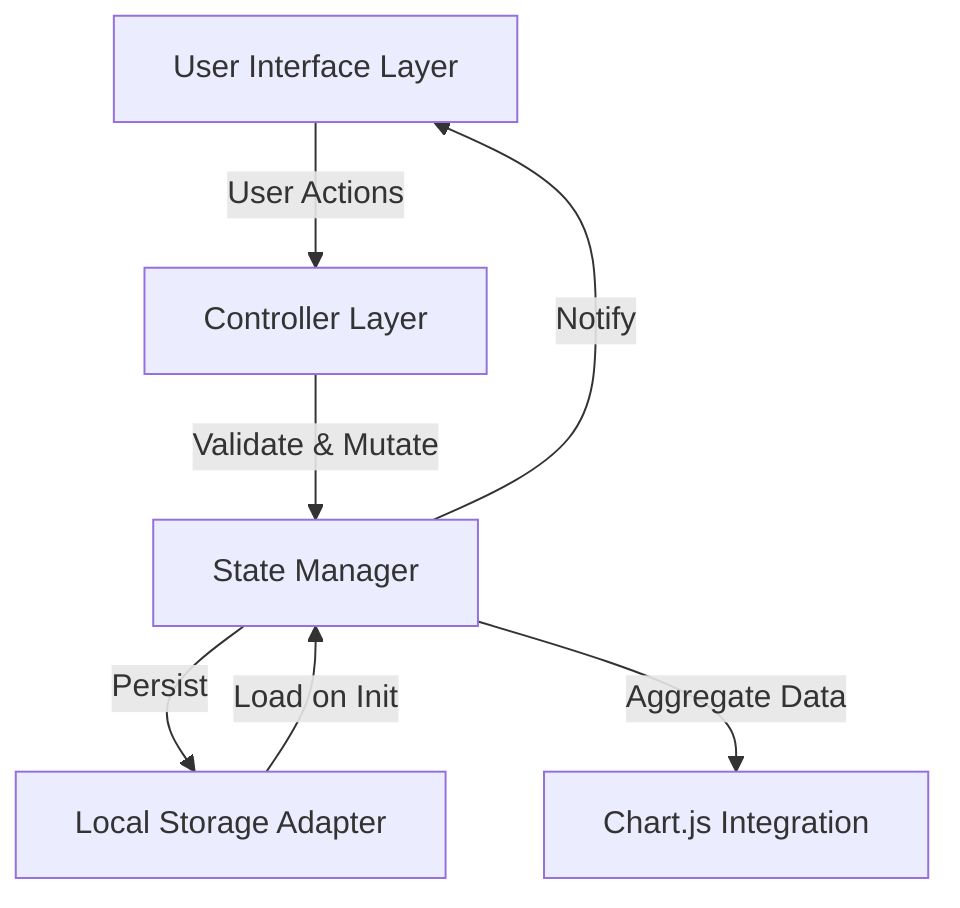

# Design Document

## Overview

The Expense & Budget Visualizer is a client-side web application that provides comprehensive expense tracking and visualization capabilities entirely within the browser. The application follows a single-page architecture with no backend dependencies, leveraging the browser's Local Storage API for persistence and Chart.js for data visualization.

### Key Design Goals

1. **Zero Infrastructure**: Run entirely in the browser with no backend server or build tooling
2. **Immediate Persistence**: Auto-save all changes to Local Storage within 300ms
3. **Live Updates**: Reflect all data changes across UI components without page reload
4. **Graceful Degradation**: Handle Local Storage failures and CDN unavailability
5. **Minimal Footprint**: Single HTML file, single CSS file, single JS file

### Technical Approach

The application uses a **reactive state management pattern** where all data mutations flow through a central state manager that:
- Validates input before committing changes
- Persists changes to Local Storage
- Notifies all registered UI components to re-render
- Maintains sort order and derived calculations (balance, category totals)

The architecture separates concerns into:
- **State Layer**: Transaction storage, category registry, persistence
- **Validation Layer**: Input validation, duplicate checking, type coercion
- **View Layer**: DOM manipulation, event binding, Chart.js integration
- **Controller Layer**: Orchestrates state mutations and view updates

---

## Architecture

### Component Structure



### Data Flow

1. **User Input → Validation → State Update → Persistence → UI Update**
2. **Page Load → Storage Read → State Initialization → UI Render**
3. **Transaction Delete → State Update → Persistence → Balance/Chart/List Update**

### Module Organization

```
index.html              # Entry point, DOM structure, Chart.js CDN link
css/
  styles.css            # Single stylesheet with component-scoped sections
js/
  app.js                # All application logic
    ├─ StateManager     # Transaction & category storage, persistence
    ├─ Validator        # Input validation rules
    ├─ TransactionForm  # Form rendering and submission handling
    ├─ TransactionList  # List rendering, sorting, deletion
    ├─ BalanceDisplay   # Total calculation and display
    ├─ ChartRenderer    # Chart.js integration and updates
    ├─ CategoryManager  # Custom category CRUD
    ├─ MonthlySummary   # Monthly aggregation and display
    └─ App              # Initialization and component wiring
```

---

## Components and Interfaces

### 1. StateManager

**Responsibility**: Central store for all transactions and categories with persistence.

**Interface**:
```javascript
class StateManager {
  constructor(storage)
  
  // Transaction operations
  addTransaction(item, amount, category) → Transaction | null
  deleteTransaction(transactionId) → boolean
  getTransactions(sortKey = null) → Transaction[]
  
  // Category operations
  addCustomCategory(name) → boolean
  getCategories() → string[]
  
  // Derived data
  getBalance() → number
  getCategoryTotals() → Map<string, number>
  getMonthlySummary() → Map<string, MonthData>
  
  // Observers
  subscribe(listener) → unsubscribe function
  
  // Persistence
  load() → void
  save() → boolean
}
```

**Key Behaviors**:
- Assigns unique IDs to transactions (timestamp + random suffix)
- Maintains insertion timestamps for tiebreaker sorting
- Notifies all subscribers after state mutations
- Handles Local Storage quota exceeded gracefully

### 2. Validator

**Responsibility**: Input validation and error message generation.

**Interface**:
```javascript
class Validator {
  static validateTransactionForm(item, amount, category) → ValidationResult
  static validateCustomCategory(name, existingCategories) → ValidationResult
  static formatAmount(amount) → number | null
  static sanitizeText(text, maxLength) → string
}

class ValidationResult {
  isValid: boolean
  errors: Map<string, string>  // fieldName → errorMessage
}
```

**Validation Rules**:
- Item name: 1–100 chars after trim
- Amount: 0.01–999,999,999.99, up to 2 decimal places
- Category: must exist in category list
- Custom category: 1–50 chars after trim, case-insensitive uniqueness

### 3. TransactionForm

**Responsibility**: Render form, handle submission, display validation errors.

**Interface**:
```javascript
class TransactionForm {
  constructor(stateManager, categories)
  
  render(containerElement) → void
  showErrors(validationResult) → void
  clearErrors() → void
  reset() → void
  updateCategories(categories) → void
}
```

**Events**:
- `submit`: Validates input, calls `stateManager.addTransaction()`, resets on success

### 4. TransactionList

**Responsibility**: Render scrollable list of transactions with delete controls and sorting.

**Interface**:
```javascript
class TransactionList {
  constructor(stateManager)
  
  render(containerElement, transactions) → void
  setSortKey(sortKey) → void  // 'amount' | 'category' | null
  getSortKey() → string | null
  renderEmptyState(containerElement) → void
}
```

**Sorting Logic**:
- Amount: descending by amount, then descending by timestamp (tiebreaker)
- Category: ascending alphabetically (case-insensitive), then descending by timestamp
- Default (null): descending by timestamp (newest first)

### 5. BalanceDisplay

**Responsibility**: Calculate and display total balance.

**Interface**:
```javascript
class BalanceDisplay {
  constructor(stateManager)
  
  render(containerElement, balance) → void
}
```

**Calculation**: Sum of all transaction amounts, formatted as currency with 2 decimal places.

### 6. ChartRenderer

**Responsibility**: Render and update Chart.js pie chart.

**Interface**:
```javascript
class ChartRenderer {
  constructor(stateManager, chartJsInstance)
  
  render(canvasElement, categoryTotals) → void
  update(categoryTotals) → void
  renderPlaceholder(containerElement) → void
}
```

**Data Mapping**: 
- Labels: Category names
- Data: Total amount per category
- Filters out categories with 0 total

### 7. CategoryManager

**Responsibility**: UI for adding custom categories.

**Interface**:
```javascript
class CategoryManager {
  constructor(stateManager)
  
  render(containerElement, existingCategories) → void
  showError(message) → void
  clearError() → void
}
```

**Events**:
- `submit`: Validates category name, calls `stateManager.addCustomCategory()`, updates form on success

### 8. MonthlySummary

**Responsibility**: Group transactions by month and display totals.

**Interface**:
```javascript
class MonthlySummary {
  constructor(stateManager)
  
  render(containerElement, summaryData) → void
}

class MonthData {
  month: string          // 'YYYY-MM'
  categoryTotals: Map<string, number>
  grandTotal: number
}
```

**Grouping Logic**: Uses transaction timestamp, groups by `YYYY-MM`, sorts descending (most recent first).

### 9. LocalStorageAdapter

**Responsibility**: Encapsulate Local Storage access with error handling.

**Interface**:
```javascript
class LocalStorageAdapter {
  static save(key, data) → boolean
  static load(key) → any | null
  static isAvailable() → boolean
}
```

**Error Handling**: Returns `null` or `false` on quota exceeded, parse errors, or unavailability.

---

## Data Models

### Transaction

```javascript
{
  id: string,           // Unique: timestamp + 6-char random suffix
  item: string,         // 1–100 chars, trimmed
  amount: number,       // 0.01–999,999,999.99, exactly 2 decimal precision
  category: string,     // Must exist in category list
  timestamp: number     // Unix milliseconds, used for sorting and grouping
}
```

### Category

```javascript
string                  // Category name, 1–50 chars, case-insensitive uniqueness
```

**Default Categories**: `["Food", "Transport", "Fun"]`

### Local Storage Schema

**Key**: `expense_tracker_transactions`  
**Value**: JSON array of Transaction objects

**Key**: `expense_tracker_categories`  
**Value**: JSON array of custom category strings (excludes defaults)

**Example**:
```json
// expense_tracker_transactions
[
  {
    "id": "1704067200000_a3f2g1",
    "item": "Lunch at cafe",
    "amount": 15.50,
    "category": "Food",
    "timestamp": 1704067200000
  },
  {
    "id": "1704153600000_b9k4m7",
    "item": "Bus fare",
    "amount": 3.00,
    "category": "Transport",
    "timestamp": 1704153600000
  }
]

// expense_tracker_categories
["Shopping", "Health"]
```

### Sort State

**In-Memory Only** (not persisted):
```javascript
{
  sortKey: 'amount' | 'category' | null
}
```

---

## Correctness Properties

*A property is a characteristic or behavior that should hold true across all valid executions of a system — essentially, a formal statement about what the system should do. Properties serve as the bridge between human-readable specifications and machine-verifiable correctness guarantees.*

### Property 1: Valid Transaction Addition Round-Trip

*For any* valid transaction (item name 1–100 chars, amount 0.01–999,999,999.99 with up to 2 decimal places, category from the available category list), submitting it through the form shall result in that transaction appearing in the transaction list and in Local Storage.

**Validates: Requirements 1.3, 9.1**

---

### Property 2: Empty-Field Validation Rejects Submission

*For any* combination of form fields where at least one field is empty (item, amount, or category not selected), the validator shall reject the submission, produce at least one error message, and leave the transaction list unchanged.

**Validates: Requirements 1.4**

---

### Property 3: Invalid Amount Validation Rejects Submission

*For any* amount value that is non-positive, non-numeric, exceeds 999,999,999.99, or has more than 2 decimal places, the validator shall reject the submission with an error message on the amount field and leave the transaction list unchanged.

**Validates: Requirements 1.5**

---

### Property 4: Form Resets After Successful Submission

*For any* valid transaction submission, the form's item name field shall be empty, the amount field shall be empty, and the category selector shall be reset to its first option after the transaction is successfully added.

**Validates: Requirements 1.6**

---

### Property 5: Transaction List Currency Formatting

*For any* transaction in the list, the rendered entry shall contain the item name, the category name, and the amount formatted with a currency symbol followed by a numeric value with exactly 2 decimal places.

**Validates: Requirements 2.2**

---

### Property 6: Transaction List Default Sort Order

*For any* set of transactions loaded from Local Storage, the transaction list shall render them in descending order by recorded timestamp (most recently added first).

**Validates: Requirements 2.4**

---

### Property 7: Every Transaction Entry Has a Visible Delete Control

*For any* set of transactions rendered in the transaction list, every entry shall have a delete control that is visible without requiring hover or additional interaction.

**Validates: Requirements 3.1**

---

### Property 8: Delete Transaction Round-Trip

*For any* transaction that exists in the list, activating its delete control shall remove it from the transaction list display and from Local Storage, and shall update the balance to equal the previous balance minus the deleted transaction's amount.

**Validates: Requirements 3.2, 3.4, 4.3, 9.1**

---

### Property 9: Balance Equals Sum of All Transactions

*For any* set of transactions, the displayed balance shall equal the arithmetic sum of all transaction amounts, regardless of how many transactions there are or which categories they belong to.

**Validates: Requirements 4.1, 4.2, 4.4**

---

### Property 10: Chart Reflects Current Category Totals

*For any* set of transactions (including custom-category transactions), the chart dataset shall contain exactly one entry per category that has at least one transaction, with each entry's value equal to the sum of all transaction amounts in that category, and no entry for categories with zero transactions.

**Validates: Requirements 5.1, 5.2, 5.3, 6.5**

---

### Property 11: Valid Custom Category Addition Round-Trip

*For any* category name that is non-empty after trimming and does not case-insensitively match any existing category, submitting it shall add the category to the selector and persist it to Local Storage.

**Validates: Requirements 6.2, 9.2**

---

### Property 12: Invalid Custom Category Rejected

*For any* category name that is empty after trimming, whitespace-only, or that case-insensitively matches any existing category name, the validator shall reject the submission with a specific error message and shall not add the category to the list.

**Validates: Requirements 6.3**

---

### Property 13: Custom Categories Loaded on Start

*For any* set of custom categories persisted in Local Storage, loading the application shall include all those categories in the category selector before any user interaction.

**Validates: Requirements 6.4**

---

### Property 14: Monthly Summary Grouping Correctness

*For any* set of transactions spanning multiple calendar months, the monthly summary shall contain exactly one group per distinct month-year present in the transaction set, each group showing the correct per-category totals and the correct grand total for that month, with groups ordered from most recent to oldest.

**Validates: Requirements 7.1, 7.2, 7.3, 7.4, 7.5**

---

### Property 15: Amount Sort Preserves Descending Order

*For any* set of transactions, applying the amount sort shall produce a list ordered from highest amount to lowest amount, with ties broken by descending recorded timestamp.

**Validates: Requirements 8.2**

---

### Property 16: Category Sort Preserves Alphabetical Order

*For any* set of transactions with varying category names (including mixed case), applying the category sort shall produce a list ordered alphabetically by category name in a case-insensitive comparison.

**Validates: Requirements 8.3**

---

### Property 17: Sort Order Preserved After Insert

*For any* active sort key (amount or category), adding any valid transaction shall produce a resulting list that is still correctly sorted according to that sort key.

**Validates: Requirements 8.4**

---

## Error Handling

### Local Storage Failures

| Failure Type | Trigger | Recovery Behavior |
|---|---|---|
| Unavailable | `localStorage` throws `SecurityError` | Display persistent warning, initialize with empty state |
| Quota Exceeded | `setItem()` throws `QuotaExceededError` | Display persistent warning, retain in-memory state, explain storage is full |
| Corrupt Data | `JSON.parse()` throws `SyntaxError` | Display error message, initialize with empty list |
| Delete Failure | `removeItem()` throws | Display error message, retain transaction in list |

### Error Message Placement

- **Form validation errors**: Inline, adjacent to the offending field, with `role="alert"` for accessibility
- **Storage errors**: Persistent banner at the top of the page, below the balance display
- **Chart CDN failure**: Inline within the chart container, replacing the canvas element
- **Delete failure**: Inline notification near the transaction list

### Error Dismissal

- Form validation errors clear automatically when the user corrects the field or when the form is reset
- Storage and CDN error banners persist and are not automatically dismissed (they represent ongoing state issues)
- Delete failure notifications auto-dismiss after 5 seconds

### Defensive Parsing

When loading from Local Storage, every transaction object is validated against the Transaction schema before being accepted:
- `id` must be a non-empty string
- `item` must be a string with 1–100 chars
- `amount` must be a finite number within the valid range
- `category` must be a non-empty string
- `timestamp` must be a positive integer

Transactions that fail schema validation are silently discarded, and the remaining valid transactions are loaded.

---

## Testing Strategy

### Approach

This application uses a **dual testing approach**:

1. **Property-based tests** for validation logic, data transformations, sorting algorithms, aggregation calculations, and persistence round-trips — these functions have clear input/output behavior and benefit from randomized input coverage.
2. **Example-based unit tests** for specific UI behaviors, error state rendering, initialization edge cases, and CDN failure handling.

Property-based testing is applicable because the app contains substantial pure-function logic (validation, sorting, aggregation, formatting) where universal properties can be expressed and where randomized inputs reveal edge cases that hand-picked examples miss.

### Property-Based Testing

**Library**: [fast-check](https://github.com/dubzzz/fast-check) — a mature JavaScript property-based testing library with no build-step dependency requirement.

**Configuration**: Each property test runs a minimum of **100 iterations**.

**Tag format**: Each property test includes a comment:
```javascript
// Feature: expense-budget-visualizer, Property N: <property_text>
```

**Scope**: Properties 1–17 each map to a single property-based test targeting the pure logic layer (Validator, StateManager, sort functions, aggregation functions). These tests do not test DOM interactions directly — they test the functions that compute the data the DOM renders.

**Example test structure**:
```javascript
import fc from 'fast-check';

// Feature: expense-budget-visualizer, Property 9: Balance equals sum of all transactions
test('balance equals sum of all transactions', () => {
  fc.assert(
    fc.property(
      fc.array(validTransactionArb),
      (transactions) => {
        const state = new StateManager(mockStorage);
        transactions.forEach(t => state.addTransaction(t.item, t.amount, t.category));
        const expected = transactions.reduce((sum, t) => sum + t.amount, 0);
        expect(state.getBalance()).toBeCloseTo(expected, 2);
      }
    ),
    { numRuns: 100 }
  );
});
```

### Unit Tests (Example-Based)

**Framework**: [Vitest](https://vitest.dev/) — works without a build step when used with vanilla JS modules.

Unit tests cover:
- Form renders with correct fields (Req 1.1, 1.2)
- Scrollable container exists (Req 2.3)
- Empty-state message renders when no transactions (Req 2.5)
- Storage unavailable → empty list + error message (Req 2.6, 4.5, 9.4)
- Storage failure on delete → transaction retained + error shown (Req 3.3)
- All transactions deleted → chart placeholder shown (Req 5.4)
- Chart.js CDN failure → error message shown (Req 5.6)
- Custom category control exists in UI (Req 6.1)
- Sort control exists with Amount and Category options (Req 8.1)
- Sort key not persisted to Local Storage (Req 8.5)

### Integration Tests

- Cross-browser smoke check: app loads and renders in Chrome, Firefox, Edge, Safari (Req 10.4)
- Chart.js CDN script tag present in HTML (Req 5.5)
- File structure compliance: single CSS in `css/`, single JS in `js/` (Req 10.2, 10.3)

### Accessibility

All interactive elements include:
- `aria-label` on icon-only buttons (delete controls)
- `role="alert"` on inline validation error messages
- Semantic HTML (`<form>`, `<button>`, `<ul>`, `<li>`, `<section>`)
- Sufficient color contrast for text and chart segments
- Keyboard navigability for all form controls and buttons
